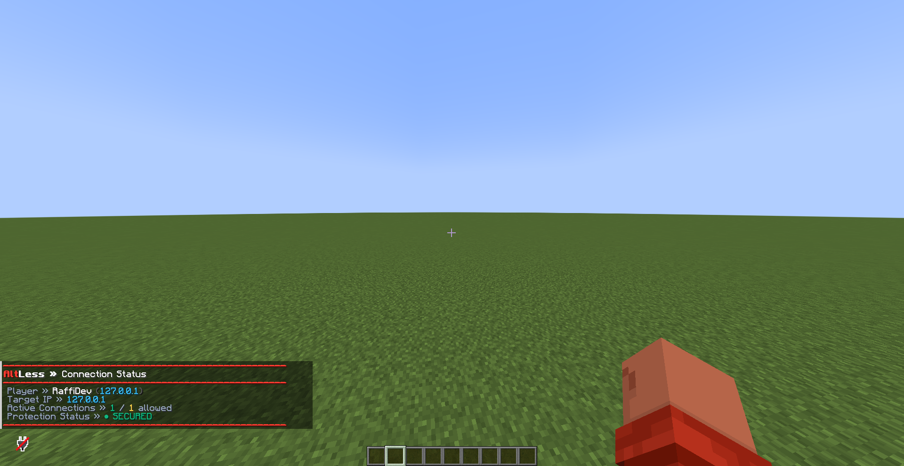
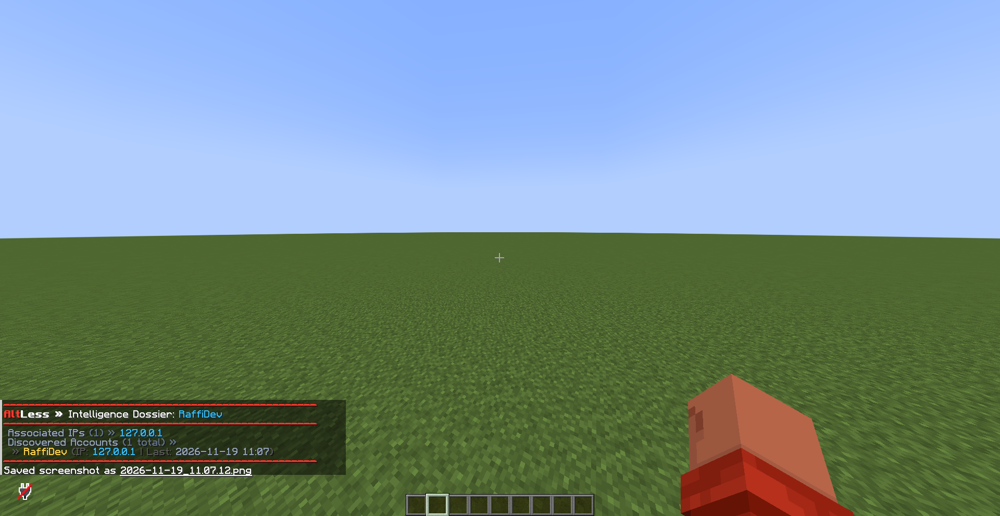

# Commands and Permissions ⚔️

Altless provides an intuitive, lightweight command system designed for staff and server administrators. All subcommands feature auto-completion and responsive, asynchronous execution.

---

## 💻 Commands Overview

Base command: `/altless` (Aliases: `/alts`, `/iplimit`)


| Command | Permission | Description |
|---|---|---|
| `/altless help` | `altless.admin` | Display all available commands and syntax. |
| `/altless status [ip]` | `altless.admin` | View live metrics: tracked IPs, active sessions, and protection state. |
| `/altless lookup <player\|ip>` | `altless.admin` | Investigate all associated alt accounts linked to a player name or IP address. |
| `/altless list [ip]` | `altless.admin` | List all active players connected from a specific IP address (or all tracked IPs). |
| `/altless set <target> <limit>` | `altless.admin` | Set a temporary or custom override limit for a player or IP (`0` to reset). |
| `/altless reload` | `altless.admin` | Hot-reload `config.yml` and message files without restarting the server. |

---

## 📊 Live Connection Status (`/altless status`)

Monitor active concurrent connections and verify protection status for any online player or specific IP address:



---

## 🔍 Alt Intelligence & Audit Trail (`/altless lookup`)

When a player or IP is investigated with `/altless lookup`, Altless queries the local audit trail:
- Resolves player username to known UUIDs.
- Displays all IP addresses the player has joined from.
- Cross-references each IP to find all other player names sharing those addresses.
- Highlights whether associated accounts are currently online or offline, complete with last seen timestamps.



---

## ⚙️ Dynamic Limit Management (`/altless set`)

Need to give a temporary exemption to a family or internet cafe without modifying configuration files and restarting? Use `/altless set`:

```bash
# Allow player RaffiDev (and their IP) up to 3 concurrent connections
/altless set RaffiDev 3

# Reset custom limit back to default
/altless set RaffiDev 0
```


---

## 🔑 Permissions

Altless uses a clean, granular permission structure compatible with all modern permission managers (such as **LuckPerms**).

| Permission | Default | Description |
|---|---|---|
| `altless.admin` | `op` | Grants access to `/altless` management commands and tab completion. |
| `altless.bypass` | `false` | Completely exempts the player from connection limits and rate limiting. |
| `altless.notify` | `op` | Receives live staff security alerts when players exceed connection thresholds. |
| `altless.limit.<n>` | `false` | Sets a custom account limit for the player or group (e.g. `altless.limit.3`). |

---

## 🌟 Dynamic Limit Hierarchy (LuckPerms)

Altless dynamically calculates a player's allowed connection limit upon login using the following priority order:

1. **Bypass Check:** If the player has `altless.bypass`, they are never restricted.
2. **Numeric Permission Nodes (`altless.limit.<n>`):**
   - Altless checks for highest integer value `n` among all assigned permission nodes.
   - *Example:* If a VIP player has both `altless.limit.2` and `altless.limit.4`, Altless grants a limit of **4**.
3. **Global Default:** If no numeric permission node is assigned, Altless falls back to `defaultLimit` from `config.yml`.

### Example: Setting VIP Limits with LuckPerms

```bash
# Allow VIP group to connect up to 3 accounts from the same household/IP
/lp group vip permission set altless.limit.3

# Allow MVP group to connect up to 5 accounts
/lp group mvp permission set altless.limit.5

# Give Staff members instant alert notifications on alt violations
/lp group mod permission set altless.notify true
/lp group admin permission set altless.admin true
```
