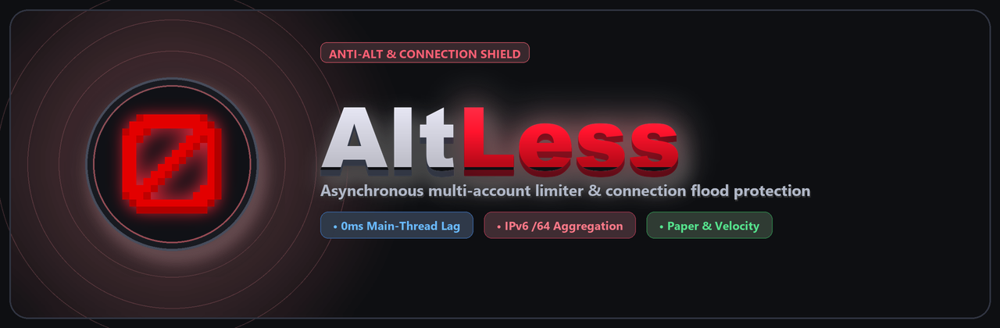
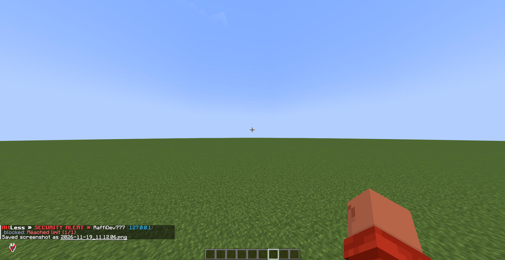
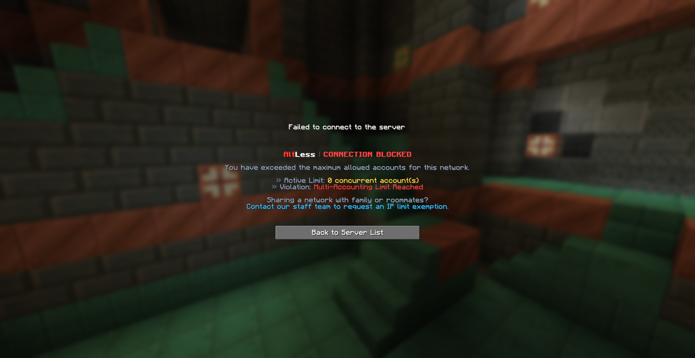

# Altless Documentation 🛡️

### High-Performance Asynchronous Connection & Multi-Account Limiter
**Designed for modern Paper (1.17-1.21+) servers and Velocity (3.1-3.3+) proxies.**

---

**Altless** is an ultra-lightweight, zero-dependency connection and alt-account limiter engineered from scratch to protect Minecraft networks from bot raids, IP rotation evasion, and alt spam - with **strictly 0ms overhead** on the main server thread.

---

## 📸 In-Game Feature Showcase

### 🚨 Real-Time Staff Security Alerts
*Instantaneous notifications delivered to staff with `altless.notify` whenever an unauthorized alt connection is blocked.*

---

### 🛑 Enforced Connection Limit (Kick Screen)
*Blocked connections receive an informative, branded RGB disconnect card instead of generic timeout errors.*

---

## 🚀 Why Altless?

Most legacy IP limiter plugins suffer from serious design flaws:
* 🛑 **Main Thread Lag:** Running database queries or connection checks during sync login events freezes the main tick loop.
* 🛑 **Memory Leaks:** Storing raw `Player` objects in static collections prevents players from being garbage collected after logout.
* 🛑 **IPv6 Evasion:** Botnets rotate random IPv6 host addresses within the same ISP subnet to bypass single-IP limits.
* 🛑 **No Flood Protection:** While checking account caps, bots can still spam 100 connection handshakes per second.

**Altless solves all of these problems out of the box:**
1. **100% Asynchronous:** Hooks early handshake events (`AsyncPlayerPreLoginEvent` on Paper, `PreLoginEvent` / `LoginEvent` on Velocity).
2. **Leak-Free Concurrency:** Uses lock-free `ConcurrentHashMap` storing only immutable `UUID` references.
3. **IPv6 Subnet Aggregation:** Automatically groups IPv6 addresses under the same `/64` subnet so botnets cannot rotate IPs to bypass limits.
4. **Sliding-Window Rate Limiter:** Drops bot floods before player instances or worlds even load.
5. **Native Alt Investigation:** Integrated CSV audit trail enabling `/altless lookup <player|ip>` without heavy external SQL servers.

---

## 📊 Comparison Matrix

| Feature | Other Plugins | AltLess |
|---|---|---|
| **Supported Platforms** | Outdated / Spigot only | **Paper 1.17-1.21+ & Velocity 3.1-3.3+** |
| **Main Thread Impact** | Heavy (Sync Login) | **0ms (Fully Asynchronous)** |
| **Thread Safety** | Basic `HashMap` (Race Conditions) | **Lock-Free `ConcurrentHashMap`** |
| **IPv6 Evasion Defense** | ❌ None | **✅ Automatic `/64` Subnet Aggregation** |
| **Connection Rate Limiter** | ❌ None | **✅ Sliding-Window Token Bucket** |
| **CIDR Subnet Matching** | ❌ None | **✅ Standard CIDR (e.g. `/24`, `/16`)** |
| **Alt Investigation** | ❌ None | **✅ In-game `/altless lookup`** |
| **Automated Mitigation** | ❌ None | **✅ Auto Escalation (e.g. Auto IP-Ban)** |
| **External Dependencies** | Jedis / DB drivers | **Zero (Native Socket Redis & CSV)** |
| **Multi-Language** | Hardcoded English | **English (`en`) & Indonesian (`id`)** |

---

## 📚 Documentation Index
* [📥 Installation Guide](Installation) - Step-by-step setup on Paper, Purpur, Folia, and Velocity.
* [⚙️ Configuration Guide](Configuration) - Full breakdown of all configuration keys and options.
* [⚔️ Commands & Permissions](Commands-and-Permissions) - Command syntax, examples, and LuckPerms setup.
* [🌐 Localization Guide](Localization) - Switching languages, placeholders, and custom messages.
* [❓ FAQ & Troubleshooting](FAQ-and-Troubleshooting) - Common network issues and proxy solutions.
