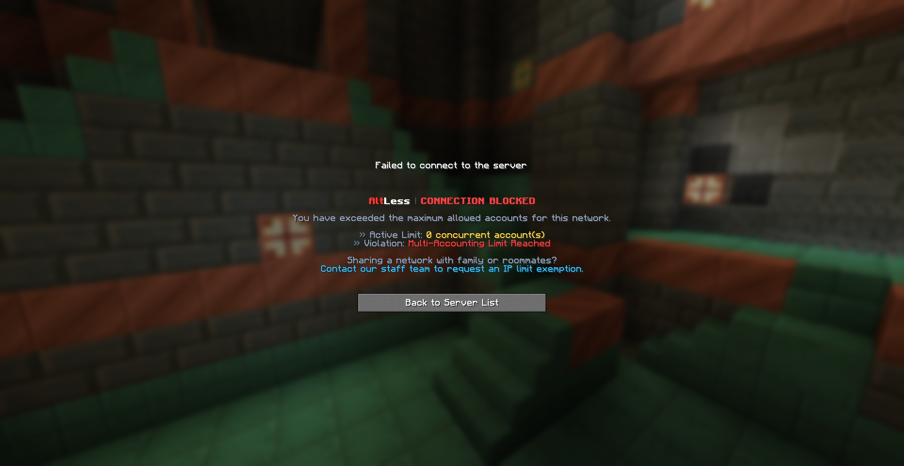
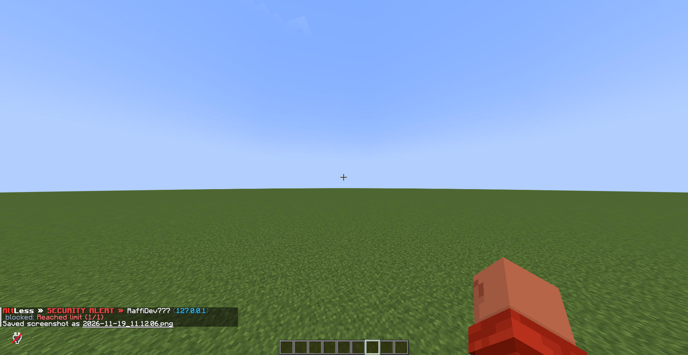

# Localization & Messages 🌐

Altless comes with full out-of-the-box multi-language support. Server administrators can switch the entire plugin's language or customize individual message strings and RGB color formats.

---

## 🗂️ Language Files

Language files are located in your server's plugin directory:

* **Paper:** `plugins/Altless/messages/`
  * `messages_en.yml` (English - Default)
  * `messages_id.yml` (Bahasa Indonesia)
* **Velocity:** `plugins/altless/messages/`
  * `messages_en.properties` (English - Default)
  * `messages_id.properties` (Bahasa Indonesia)

---

## 📸 In-Game Message Previews

### 🛑 Modern Kick Screen Card
Configure custom multi-line disconnect modals with hex color gradients:



### 🚨 Real-Time Staff Alert Card
Staff receive structured alert cards in chat:



---

## ⚙️ Switching Languages

To switch languages, edit `config.yml` on Paper or `altless.properties` on Velocity:

```yaml
# Set language: 'en' for English, 'id' for Indonesian
language: "id"
```

Save the file and apply changes immediately without a restart:
```bash
/altless reload
```

---

## 🎨 Color & Formatting Support

Altless supports legacy color codes as well as modern RGB formatting:
* Standard Minecraft color codes using `&` (e.g. `&c`, `&a`, `&e`, `&7`).
* Hex colors (on Paper 1.16+): `&#RRGGBB`.
* Multi-line kick screens: use `\n` in string values to create clean, readable line breaks on disconnect screens.

---

## 🧩 Placeholders Reference

The following placeholders are dynamically replaced by Altless in messages:

| Placeholder | Context | Description |
|---|---|---|
| `%limit%` | Disconnect / Alerts | The maximum allowed connection limit for this IP or player. |
| `%current%` | Disconnect / Alerts | The current count of active connections from this IP. |
| `%player%` | Disconnect / Alerts / Lookup | The player's username. |
| `%ip%` | Disconnect / Alerts / Lookup | The player's IP address (or aggregated IPv6 subnet). |
| `%reason%` | Disconnect / Logs | The reason for rejection (e.g., limit exceeded, rate limit). |
| `%threshold%` | Rate Limiter | The rate limit threshold (connections per window). |
| `%time%` | Rate Limiter / Audit | Window duration or timestamp. |
| `%status%` | Status Command | Operational state of backend features. |

---

## 🛠️ Adding a Custom Language

Want to add French (`fr`), Spanish (`es`), or German (`de`)?
1. Open the `plugins/Altless/messages/` folder.
2. Copy `messages_en.yml` (or `.properties`) and rename it to `messages_es.yml`.
3. Translate the strings inside.
4. Set `language: "es"` in `config.yml`.
5. Run `/altless reload`.
